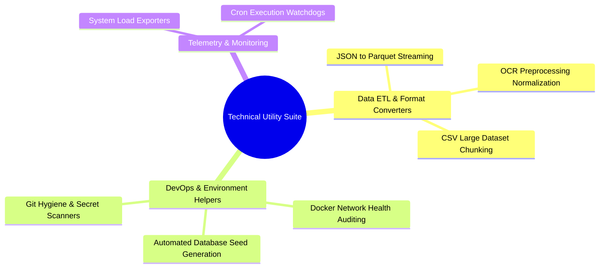

# 🛠️ Technical Utility Suite // Automation & Operations Hub

> [!NOTE]
> **INTERNAL TOOLING SPECIFICATION // PROPRIETARY SCRIPTS**  
> This repository provides the architectural index and operational overview for an internal suite of automation tooling, data ETL scripts, and system maintenance utilities.

---

## 📦 Suite Capabilities & Module Architecture

---

## ⚙️ Core Engineering Standards

- **Zero-Dependency Core:** Critical CLI utilities leverage standard library modules for maximum portability across Unix/Windows servers.
- **Defensive Error Handling:** Process isolation ensuring batch conversion failures on row $N$ do not abort long-running bulk migrations.
- **Secure Secret Handling:** Integrates with environment secret vaults rather than configuration file credentials.

---
*Maintained by [Danyal Aqeel](https://github.com/DANYALAQEEL)*
